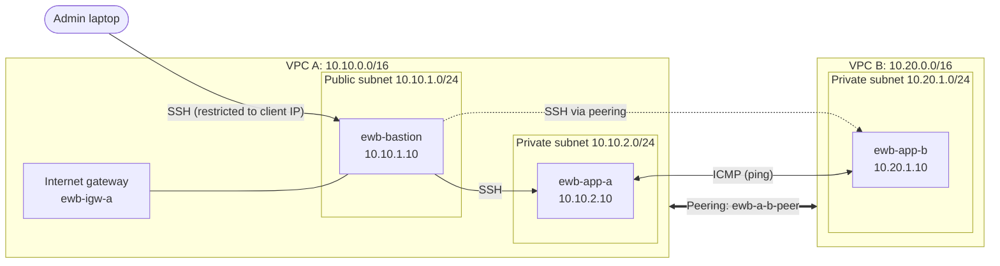

# AWS VPC Peering: EWB Cloud Labs


A hands-on AWS networking project that establishes private connectivity between two Amazon VPCs. It covers route and security group configuration, bastion-based SSH access, connectivity testing, deliberate failure troubleshooting, and safe teardown of all cloud resources.

| | |
|---|---|
| **Project** | EWB Cloud Labs: AWS VPC Peering |
| **Region** | US East (N. Virginia), `us-east-1` |
| **Status** | Lab completed; all resources cleaned up after testing |

---

## Table of Contents

- [Overview](#overview)
- [Architecture](#architecture)
- [Network Design](#network-design)
- [AWS Resources](#aws-resources)
- [Implementation](#implementation)
- [Testing and Troubleshooting](#testing-and-troubleshooting)
- [Challenges and Resolutions](#challenges-and-resolutions)
- [Cleanup](#cleanup)
- [Key Takeaways](#key-takeaways)
- [Repository Structure](#repository-structure)
- [References](#references)

---

## Overview

The goal was to connect two VPCs with AWS VPC Peering and demonstrate communication between private EC2 instances using their private IPv4 addresses.

The lab involved:

- Creating two VPCs with non-overlapping CIDR blocks
- Configuring public and private subnets
- Setting up route tables on both sides of the peering connection
- Establishing and accepting a VPC peering connection
- Implementing security group rules for SSH and ICMP
- Using a bastion host in VPC A as the single administrative entry point

Connectivity was validated in both directions, and a controlled security group change was used to show how network filtering affects communication even when peering and routing are correct.

---

## Architecture



The full architecture diagram is available in [`architecture/`](architecture/).

---

## Network Design

Both VPCs live in the same AWS account and region. Their CIDR ranges do not overlap, which is a prerequisite for VPC Peering.

| Component | Configuration |
|---|---|
| VPC A | `10.10.0.0/16` |
| VPC B | `10.20.0.0/16` |
| Public subnet (VPC A) | `10.10.1.0/24` |
| Private subnet (VPC A) | `10.10.2.0/24` |
| Private subnet (VPC B) | `10.20.1.0/24` |
| Internet gateway | `ewb-igw-a` |
| Peering connection | `ewb-a-b-peer` (`pcx-0f39d1744e019b79d`) |

### EC2 Instances

| Instance | Private IPv4 | Subnet | Role |
|---|---|---|---|
| `ewb-bastion` | `10.10.1.10` | Public (VPC A) | Public entry point for SSH administration |
| `ewb-app-a` | `10.10.2.10` | Private (VPC A) | Private workload |
| `ewb-app-b` | `10.20.1.10` | Private (VPC B) | Private workload |

Both application instances have no public IPv4 address.

### Routing Design

| Route table | Associated subnet | Routes |
|---|---|---|
| `ewb-rt-a-public` | Public, VPC A | Local; default route to the internet gateway; route to VPC B via the peering connection |
| `ewb-rt-a-private` | Private, VPC A | Local; route to VPC B via the peering connection |
| `ewb-rt-b-private` | Private, VPC B | Local; return route to VPC A via the peering connection |

> **Note:** An active peering connection does not by itself enable traffic. Routes are required on **both** sides.

---

## AWS Resources

- 2 VPCs and 3 subnets
- 1 internet gateway (attached to VPC A)
- 1 VPC peering connection
- 3 custom route tables
- 3 EC2 instances (1 bastion host, 2 private application instances)
- 3 security groups (bastion and application instances)
- 1 EC2 key pair for SSH access

Configuration and resource identifiers were recorded during the lab. All resources were removed after testing to limit ongoing costs.

---

## Implementation

1. **VPCs and subnets:** Created two VPCs with non-overlapping CIDRs, with one public and one private subnet in VPC A and one private subnet in VPC B.
2. **Internet gateway and route tables:** Attached an internet gateway to VPC A and pointed the public route table's default route at it. Configured the private route tables to send remote-VPC traffic through the peering connection.
3. **EC2 deployment:** Launched the bastion in the public subnet and the two application instances in their respective private subnets, without public IPv4 addresses.
4. **Security groups:**
   - SSH to the bastion is restricted to the configured client IP.
   - SSH to the application instances allows only the specified bastion source.
   - ICMP rules permit the required traffic between the application hosts.
5. **VPC Peering:** Created and accepted the peering request between VPC A and VPC B. The connection reached the **Active** state, after which routes were added on both sides.
6. **SSH through the bastion:** Configured local SSH host aliases and `ProxyJump` to reach the private instances without exposing them publicly.

---

## Testing and Troubleshooting

Testing covered forward and reverse ICMP, SSH access, and a controlled failure-and-recovery exercise.

### Results

| Test | Result |
|---|---|
| SSH to bastion | Successful |
| SSH to App-A through bastion | Successful |
| SSH to App-B through bastion | Successful during the lab |
| App-A → App-B ping | 4 packets received, 0% loss |
| App-B → App-A ping | 4 packets received, 0% loss |
| Controlled ICMP failure | 100% packet loss |
| Ping after restoring ICMP rule | 4 packets received, 0% loss |

### Forward Path: App-A → App-B

```bash
ping -c 4 10.20.1.10   # run from ewb-app-a (10.10.2.10)
```

Four replies, no packet loss. Traffic used App-A's subnet route table, the peering connection, and the destination-side security group rules.

### Return Path: App-B → App-A

```bash
ping -c 4 10.10.2.10   # run from ewb-app-b (10.20.1.10)
```

Four replies, no packet loss. The return route in VPC B was required for traffic to reach VPC A, and the security group rules also had to permit the ICMP traffic.

### Controlled Failure and Recovery

1. Removed the inbound ICMP Echo Request rule on `ewb-sg-app-b` that allowed traffic from `10.10.2.10/32`.
2. Ran the forward ping from App-A: **100% packet loss**.
3. Restored the same rule.
4. Re-ran the ping: **4 replies, 0% loss**.

This showed that a peering connection can remain active, with correct routes, while security group rules still block the intended traffic.

> **Testing limitation:** A baseline failure test from before peering and route configuration was not captured. The controlled security group failure was performed later and is documented separately; it is not presented as the original baseline.

---

## Challenges and Resolutions

| Challenge | Resolution |
|---|---|
| **Peering vs. routing:** an active peering connection does not guarantee reachability | Added the required routes in the public and private route tables, including the return route in VPC B |
| **Private SSH access:** application instances have no public IPv4 and cannot be reached directly from the internet | Used the bastion host with SSH `ProxyJump` |
| **ICMP troubleshooting:** correct routes do not guarantee successful pings because security groups also filter traffic | Temporarily removed the App-B ICMP rule, observed the failure, restored the rule, and confirmed recovery |
| **SSH configuration on Windows:** reaching multiple instances through one bastion was repetitive | Created reusable SSH host aliases for the bastion and private instances |
| **AWS cost management:** EC2, storage, and public IPv4 resources can incur charges while provisioned | Terminated instances and removed associated networking resources after testing (see [Cleanup](#cleanup)) |

---

## Cleanup

After collecting project evidence, all lab resources were removed to avoid ongoing AWS charges:

- [x] Terminated the three EC2 instances
- [x] Checked for leftover EBS volumes
- [x] Checked for leftover Elastic IP allocations
- [x] Deleted the peering connection
- [x] Removed the lab security groups and subnets
- [x] Deleted the custom route tables
- [x] Detached and deleted the internet gateway

Cleanup screenshots are in [`evidence/cleanup/`](evidence/cleanup/).

> AWS billing and usage reports can take time to reflect recent changes.

---

## Key Takeaways

- VPC Peering requires **non-overlapping CIDR ranges**.
- Peering is **not transitive** and **does not route automatically**; both VPCs need explicit routes.
- **Route tables and security groups are separate layers.** Connectivity needs both to be correct.
- A **bastion host with `ProxyJump`** allows administration of private instances without public IPs.
- **Deliberate failure testing** is an effective way to learn where traffic is filtered.
- Disciplined **cleanup** is part of responsible cloud work.

---

## Repository Structure

```text
EWB-AWS-VPC-Peering/
├── architecture/
│   ├── README.md
│   └── vpc-peering-architecture.png
├── evidence/
│   ├── [project screenshots]
│   └── cleanup/
│       ├── [EC2 termination evidence]
│       ├── [empty EBS volumes evidence]
│       ├── [Elastic IP verification]
│       └── [VPC cleanup evidence]
├── report/
│   └── [assessment report PDF]
└── README.md
```

*Actual filenames may differ from the examples above.*

---

## References

- [Amazon VPC Peering documentation](https://docs.aws.amazon.com/vpc/latest/peering/what-is-vpc-peering.html)
- [Amazon VPC route tables](https://docs.aws.amazon.com/vpc/latest/userguide/VPC_Route_Tables.html)
- [Amazon EC2 security groups](https://docs.aws.amazon.com/AWSEC2/latest/UserGuide/ec2-security-groups.html)